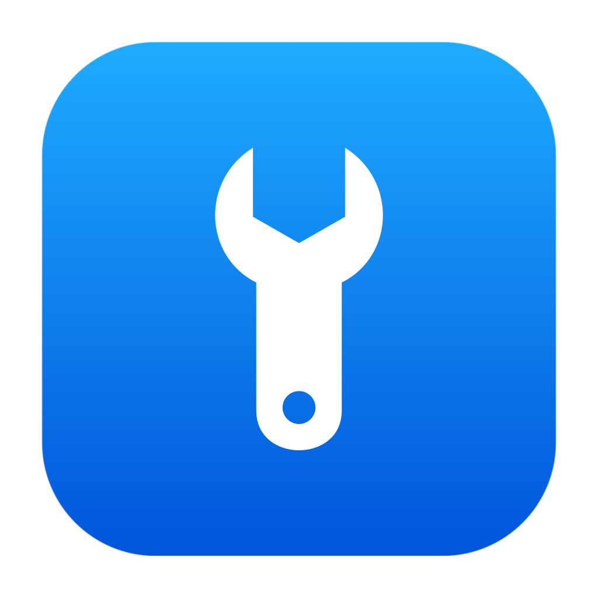

<p align="center"></p>

# 1Tool

A small, native macOS utility for everyday desktop tasks. Built with SwiftUI and AppKit, with no third-party package dependencies.

[中文](README.zh-CN.md) · [Downloads](https://github.com/natefox2017/onetool/releases) · [Builds](https://github.com/natefox2017/onetool/actions) · [Privacy](PRIVACY.md) · [Support](https://github.com/natefox2017/onetool/issues)

## Features

- **Keep Awake:** timed sessions for 30 minutes or 1 / 2 / 4 / 8 hours, indefinite sessions, and optional power-source rules. Control sessions directly from the menu bar. Changing the duration while active restarts the timer; the selected duration is remembered. Quitting releases the sleep assertions.
- **Finder Actions:** create files from templates, open favorite folders, copy paths, open folders in terminals or editors, and toggle hidden files.
- **Keyboard Backlight:** brightness, quick levels and ambient-light adjustment on supported Macs.
- **Display Brightness:** independent built-in / external display controls, DDC/CI support, and software dimming that restores the original curves on quit.
- **Input Sources:** a global default and per-app rules, with optional Caps Lock clearing. Rules save automatically and survive restarting the app; they are off by default.
- **Storage Cleanup:** disk usage and cache charts, per-app and per-directory selection, protected active/recent/linked files, recoverable Trash cleanup and explicit permanent deletion. [Cleanup scope](docs/CLEANUP.md).
- **App Uninstaller:** search installed apps, review and select related data, then confirm moving it to the Trash with a recovery manifest. Protects system apps, running processes and shared data. [Uninstall scope](docs/UNINSTALL.md).
- **Packages:** manage Homebrew formulae / casks and global npm packages, including update checks, individual or bulk upgrades, environment selection and operation logs. [Package management](docs/PACKAGES.md).
- **About:** version, source repository, license and upstream notices.
- **Permissions** — Automation status, file-access settings, Finder extension and login status with explicit request and recheck actions.
- **Make it yours:** native sidebar navigation, nine app accents, a global Liquid Glass option, 32 menu bar icons and optional launch at login. The active Keep Awake icon turns green.
- **System Appearance:** change macOS light / dark / automatic mode from settings or the status menu; app windows follow the system. [Behavior and validation](docs/SYSTEM-APPEARANCE.md).

English, Simplified Chinese, Traditional Chinese, Japanese, Korean, French, German and Spanish are included. Choose a language in General or follow the system. Standard macOS dialogs follow the system language.

## Screenshot

[](docs/images/app-en.png)

The English app, presented in an AI-generated frame. [View the original, unedited screenshot](docs/images/app-en.png).

## Download and install

Download a DMG from [Releases](https://github.com/natefox2017/onetool/releases), open it, and drag **1Tool** into **Applications**. Requires macOS 14 or later; release builds support Apple Silicon and Intel Macs. An empty Releases page means no distribution release has been published yet.

Packages are labeled `notarized`, `signed-unnotarized`, `development`, or `unsigned` according to their actual signing level. Configure Developer ID credentials for automatic signing and Apple notarization; see [release setup](RELEASING.md).

## Build from source

Requires full Xcode 26+ (including `xcstringstool`). There are no external Swift packages.

```sh
git clone https://github.com/natefox2017/onetool.git
cd onetool
./build.sh                         # build/1Tool.app, including Finder extension
./test.sh                          # run after building compiled localizations
./build.sh --install               # back up and replace /Applications/1Tool.app
ARCHS="arm64 x86_64" ./build.sh    # universal binary
```

Local builds prefer Developer ID Application, then Apple Development, then ad-hoc signing. Set `CODE_SIGN_IDENTITY` to choose explicitly. A local development signature does not imply notarization. `./test.sh --hardware` additionally changes and restores real input, backlight and display state; run it only on a Mac you control.

## Automatic DMG builds

The [Build DMG workflow](.github/workflows/release.yml) runs on pushes to `main`, version tags (`v*`) and manual dispatches. Main/manual runs upload the matching **notarized-dmg** or **unsigned-dmg** artifact; version tags also publish direct downloads in GitHub Releases. Tags must match the version in `Resources/Info.plist`.

Signing and notarization activate when the documented certificate and Apple credentials are configured; otherwise builds remain explicitly unsigned. See [RELEASING.md](RELEASING.md) for local packaging and checksum verification.

## First use and compatibility

Enable Finder Actions, then allow the bundled Finder extension in System Settings. The app stays running to handle Finder requests. macOS may request file or Automation access for actions you choose. Toggling hidden files restarts Finder; finish ongoing Finder operations first.

Enable DDC/CI on external displays. Hardware brightness and keyboard backlight depend on private macOS interfaces and can vary with the Mac, operating system, monitor and adapter. Unsupported hardware is reported in the app; software dimming is available for compatible displays. macOS still controls lid closure, shutdown and forced sleep.

Enable the input sources you need in System Settings before creating rules. Avoid enabling two automatic input-switching utilities together.

1Tool runs in the menu bar and does not show a Dock icon. Open its settings from the menu bar panel or the status icon's right-click menu. Closing the settings window keeps the app running.

## Contributing and license

Bug reports and focused pull requests are welcome. Read [CONTRIBUTING.md](CONTRIBUTING.md) and [SECURITY.md](SECURITY.md). See [DESIGN.md](DESIGN.md) for UI conventions and [validation notes](docs/VALIDATION.md) for the current evidence boundary.

GPL-3.0-or-later. Adapted components retain their upstream notices; see [NOTICE.md](NOTICE.md) and [porting notes](docs/PORTING.md). The blue-and-white wrench artwork is original to this project.
