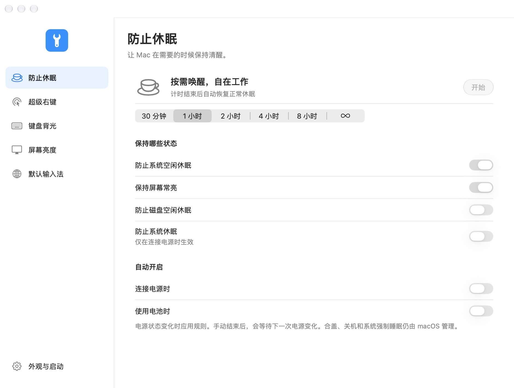

# 1Tool

轻量原生 macOS 工具，使用 SwiftUI 与 AppKit，无第三方包依赖。

[English](README.md) · [下载](https://github.com/natefox2017/onetool/releases) · [构建工作流](https://github.com/natefox2017/onetool/actions) · [隐私政策](PRIVACY.md)

- **防止休眠**：30 分钟、1/2/4/8 小时或无限会话，可按电源来源自动开启。
- **Finder 右键操作**：文件模板、常用目录、复制路径、打开终端或编辑器、显示隐藏文件。
- **键盘背光**：亮度、快捷百分比和环境光自动调节。
- **逐屏亮度**：内置屏幕、DDC/CI 外接显示器及软件调暗；退出时恢复原屏幕曲线。
- **默认输入法**：全局默认、应用专属规则及可选 Caps Lock 关闭。
- **原生外观**：浅色／深色／自动主题、九种主色调、八种语言、自定义菜单栏图标和登录启动。



需要 macOS 14+。正式 DMG 同时支持 Apple Silicon 与 Intel。

```sh
./build.sh
./test.sh
./build.sh --install
ARCHS="arm64 x86_64" ./build.sh
```

源码构建需要完整 Xcode 26+。首次使用 Finder 操作时需启用 Finder 扩展；输入法规则默认关闭；外接显示器需支持并开启 DDC/CI。硬件接口兼容性取决于 Mac、系统版本、显示器和连接方式。退出会结束防休眠并恢复软件调暗。

GitHub 签名工作流会在 main 推送、版本标签或手动运行时自动打包：Developer ID 签名应用和 DMG，完成 Apple 公证、票据装订与 Gatekeeper 检查后上传产物。版本标签同时创建 Release。首次配置需要五个仓库 Secrets，见 [RELEASING.md](RELEASING.md)。开发构建使用本机开发签名或临时签名，不能替代正式分发签名。

GPL-3.0-or-later；上游来源和版权见 [NOTICE.md](NOTICE.md)。欢迎提交问题和 Pull Request。
