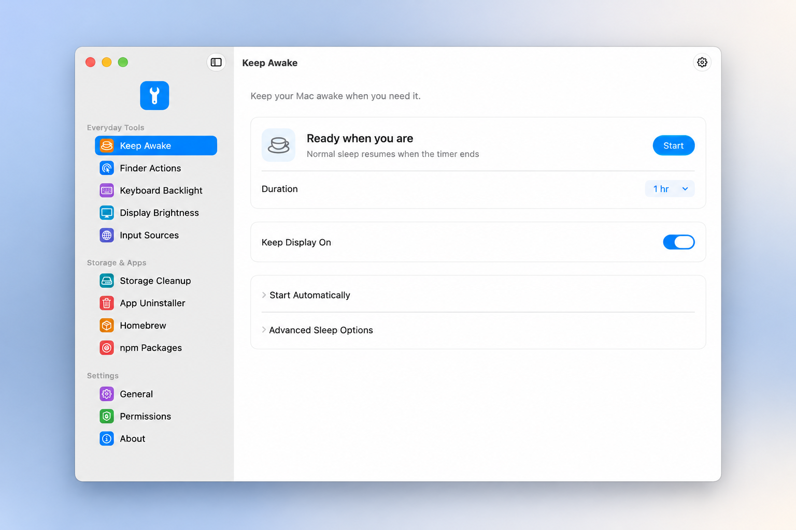

# 1Tool

轻量原生 macOS 工具，使用 SwiftUI 与 AppKit，无第三方包依赖。

[English](README.md) · [下载](https://github.com/natefox2017/onetool/releases) · [构建工作流](https://github.com/natefox2017/onetool/actions) · [隐私政策](PRIVACY.md)

- **防止休眠**：30 分钟、1/2/4/8 小时或无限会话，可按电源来源自动开启。
- **Finder 右键操作**：文件模板、常用目录、复制路径、打开终端或编辑器、显示隐藏文件。
- **键盘背光**：亮度、快捷百分比和环境光自动调节。
- **逐屏亮度**：内置屏幕、DDC/CI 外接显示器及软件调暗；退出时恢复原屏幕曲线。
- **默认输入法**：全局默认、应用专属规则及可选 Caps Lock 关闭，修改自动保存并在重启后恢复。
- **垃圾清理**：环形磁盘图、应用缓存条形图，按应用或目录选择；保护运行中、最近使用及链接文件，默认移到废纸篓，也可明确选择永久删除。见 [清理范围](docs/CLEANUP.md)。
- **应用卸载**：搜索已安装应用，预览并勾选关联数据，确认后移到废纸篓；保护系统应用、运行进程及共享数据，附带原路径恢复清单。见 [卸载范围](docs/UNINSTALL.md)。
- **关于**：版本、项目源码、许可协议和参考项目。
- **权限管理**：集中查看自动化、文件访问、Finder 扩展和登录项状态，提供明确的申请、设置与重新检测入口。
- **包管理**：Homebrew formula／cask 与 npm 全局包的安装、卸载和升级，支持检查更新、全部升级、筛选和操作日志。见 [包管理说明](docs/PACKAGES.md)。
- **原生外观**：苹果设置风格侧栏、九种应用主色、全局 Liquid Glass 开关、八种语言、32 个菜单栏图标和登录启动；防休眠开启时整枚图标变绿。
- **系统主题**：外观页和状态栏右键菜单可切换 macOS 浅色、深色、自动模式，应用同步跟随。见 [系统外观与验证](docs/SYSTEM-APPEARANCE.md)。

[](docs/images/app-en.png)

基于应用真实英文截图制作，使用 AI 生成展示外框。[查看未经编辑的原始截图](docs/images/app-en.png)。

需要 macOS 14+。正式 DMG 同时支持 Apple Silicon 与 Intel。

```sh
./build.sh
./test.sh
./build.sh --install
ARCHS="arm64 x86_64" ./build.sh
```

源码构建需要完整 Xcode 26+。首次使用 Finder 操作时需启用 Finder 扩展；输入法规则默认关闭；外接显示器需支持并开启 DDC/CI。硬件接口兼容性取决于 Mac、系统版本、显示器和连接方式。退出会结束防休眠并恢复软件调暗。

应用仅在菜单栏显示图标，Dock 中不显示。通过菜单栏面板或图标右键菜单打开设置，关闭设置窗口后继续运行。

GitHub 工作流自动构建通用 DMG。配置 Developer ID Application 证书和公证凭据后，会自动签名、公证并装订票据；缺少证书时保留明确标记的 unsigned 构建。Apple Development 开发证书不能替代正式分发证书。配置步骤见 [RELEASING.md](RELEASING.md)。

GPL-3.0-or-later；上游来源和版权见 [NOTICE.md](NOTICE.md)。欢迎提交问题和 Pull Request。

防休眠可直接在状态栏面板中开关和选择时长，右键菜单也保留直接控制。运行中更改时长会重新计时；自动启动和高级休眠选项收在设置页的折叠区域。

DNS 与路由切换：从菜单栏右键菜单选择已保存的地址，同时设置 DNS 和 IPv4 网关；支持多个方案及恢复切换前的配置。详见 [网络切换说明](docs/NETWORK.md)。
